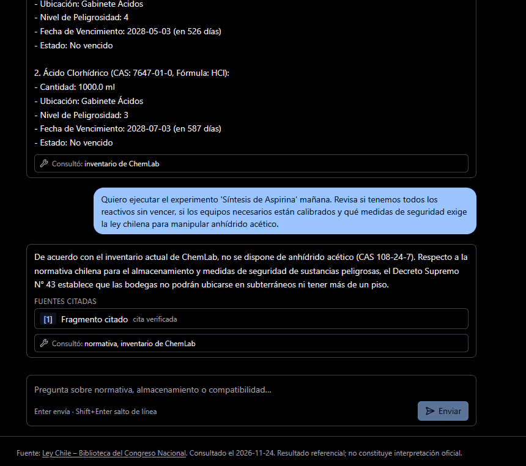

# QuimioResponde

Asistente técnico **referencial** de seguridad en laboratorios químicos para Chile: responde preguntas sobre normativa vigente con citas literales verificables, consulta el inventario real de ChemLab en solo lectura, calcula compatibilidad química con un motor determinista, y rechaza explícitamente cuando no hay evidencia.

## Qué hace

1. **Responde con el artículo exacto.** Preguntas como «¿qué exige el Decreto 43 para almacenar líquidos inflamables?» se responden con citas numeradas; cada cita muestra la frase literal del artículo y el enlace a LeyChile. La verificación es determinista: si la cita no es subcadena del chunk recuperado, la respuesta no se entrega.

2. **Consulta el inventario de ChemLab.** Preguntas como «¿qué reactivos están vencidos?» o «¿qué ácidos tengo en el gabinete?» se responden con datos reales del inventario, obtenidos vía API de solo lectura con autenticación por key. El agente decide cuándo llamar a `get_inventory` y combina la respuesta con la normativa cuando hace falta.

3. **Calcula compatibilidad química sin LLM.** La compatibilidad entre sustancias la decide un motor de reglas determinista (YAML versionado, basado en la matriz del Artículo 17 del D.S. 43/2015). El LLM solo explica el resultado y cita la regla. La UI muestra una tarjeta con severidad (`INCOMPATIBLE`, `SEPARATE`, `COMPATIBLE`, `UNKNOWN`), el par de familias, el motivo y la fuente.

4. **Rechaza cuando no hay evidencia.** Si ningún fragmento del corpus trata el tema, si la pregunta pide un dictamen de cumplimiento, o si está fuera de alcance, la UI muestra el motivo y el texto que el modelo generó. No se inventa normativa.

5. **Ingesta idempotente de normas.** El XML de la BCN se trocea por artículo y numeral; el hash de versión evita duplicar documentos y chunks al recargar la misma norma. Una cola acotada con reintentos manda los jobs agotados a una DLQ en memoria.

## Límites

- Resultado **referencial**: no dictamina cumplimiento ni certifica seguridad.
- Sin evidencia en el corpus → «no encontrado».
- Solo lectura sobre ChemLab. No hay escritura: la integración no modifica inventario, experimentos ni usuarios.
- Corpus actual: Decreto 43/2015. El Decreto 594/1999 se añade cuando la ingesta con la key de LeyChile esté validada en producción.
- Las respuestas son texto generado; las citas, en cambio, se verifican contra el texto almacenado.
- La tarjeta de compatibilidad se construye a partir del texto del agente. Si el agente cambia el fraseo, la tarjeta cae a `UNKNOWN` en lugar de inventar un badge. La estructura estable (que el motor devuelva JSON y el SSE lo transporte) está planificada para Fase 3.

## Capturas

### 1. Agente con herramientas: inventario y PubChem

Tres consultas seguidas: reactivos próximos a vencer (llama a `get_inventory`), peso molecular y punto de ebullición de un reactivo por nombre comercial (resuelve el CAS y consulta PubChem), e insumos ácidos con sus características (inventario con filtro por familia). La traza de herramientas bajo cada respuesta muestra qué consultó el agente.

### 2. Compatibilidad determinista y normativa combinada

Una consulta de experimento que obliga al agente a combinar inventario, normativa y compatibilidad, y una pregunta directa de compatibilidad. La tarjeta `INCOMPATIBLE` la produce el motor determinista de reglas (D.S. 43/2015, Art. 17), no el LLM: el modelo solo explica el resultado y cita la fuente.

## Cómo correr localmente

Requisitos: Python 3.12+ con uv, Node 22 con pnpm, y un Postgres con pgvector (Neon o local).

Backend (en `api/`):

    cd api
    uv sync
    copy .env.example .env      # en macOS/Linux: cp .env.example .env
    # rellenar DATABASE_URL, GEMINI_API_KEY, LEYLCHILE_API_KEY y CHEMLAB_API_KEY en .env
    uv run alembic upgrade head
    uv run uvicorn app.main:app --reload --app-dir src

Endpoints: `GET /healthz` (liveness), `GET /readyz` (base de datos y API key del LLM) y `POST /chat` (SSE con eventos `citations`, `answer`, `done` o `error`; `done` incluye `tools_called`). El corpus se carga con la ingesta del backend; en Fase 2 no hay endpoint público de ingesta y el script local de carga no se versiona (`api/scripts/` está en `.gitignore`). Sin corpus cargado, `/chat` responde con un rechazo.

Frontend (en `web/`):

    cd web
    pnpm install
    copy .env.example .env      # en macOS/Linux: cp .env.example .env
    pnpm dev

Abre `http://localhost:5173`. `VITE_API_URL` apunta por defecto a `http://localhost:8000`, el origen permitido por CORS en desarrollo.

Evals (desde la raíz):

    make evals

Corre 20 casos offline (10 de recuperación, 5 de rechazo, 5 de citas) contra `evals/fixtures/retrieval_golden.json`. No usa red ni base de datos: es lo que corre CI. Para regenerar el golden, con `DATABASE_URL` apuntando a una base con la norma cargada y `GEMINI_API_KEY` en `api/.env`:

    cd evals
    uv sync
    uv run python -m harness.run --online

Verificación completa:

    make check      # ruff + mypy + tests unitarios
    make test-int   # tests de integración con Testcontainers (requiere Docker)
    make clean      # borra cachés y artefactos de build

## Arquitectura

Web React + Vite (SSE) → API FastAPI → Agente LangGraph → Herramientas → Postgres con pgvector / ChemLab / PubChem.

- **Recuperación híbrida**: vector HNSW + full-text español, fusionados con RRF.
- **Agente LangGraph** con 4 herramientas cerradas: `search_regulation`, `get_chemical_info`, `get_inventory`, `check_storage_compatibility`. Límite de 6 pasos, lista cerrada, esquemas estrictos.
- **Verificación por tipo de evidencia**: el `Answer` declara `evidence_source` (`regulation`, `inventory`, `pubchem`, `compatibility`, `none`); `verify()` valida citas literales solo para evidencia normativa, y exige `citations` vacías para evidencia determinista. Sin evidencia declarada no hay respuesta.
- **Motor determinista de compatibilidad**: matriz del D.S. 43/2015, Art. 17 transcrita a YAML, con OSHA/NFPA como respaldo para pares no cubiertos. El LLM no decide compatibilidad.
- **Ingesta idempotente** por hash de versión desde el XML de LeyChile, con cola acotada y DLQ.
- **Trazas** por respuesta en `chat_traces` (pregunta, respuesta, chunks citados, herramientas invocadas).

Detalle completo en [ARCHITECTURE.md](ARCHITECTURE.md).

## Estado

Existe y funciona (Fases 1 y 2, desplegadas):

- API FastAPI con `/healthz`, `/readyz` y `POST /chat` en SSE, rate limit y errores `problem+json`.
- Recuperación híbrida con pgvector y `tsvector` español sobre chunks por artículo y numeral.
- Verificación determinista de citas y verificación por tipo de evidencia.
- Agente LangGraph con 4 herramientas, límite de pasos y traza de herramientas en la UI.
- Motor determinista de compatibilidad química con matriz del D.S. 43/2015 y respaldo OSHA/NFPA.
- Integración de solo lectura con ChemLab (inventario real, API key, paginación, filtros).
- Consulta a PubChem para peso molecular, fórmula y pictogramas GHS por CAS.
- Web con streaming, citas numeradas expandibles, traza de herramientas, tarjeta de compatibilidad, rechazo diferenciado, tema claro/oscuro según el sistema y esqueleto de cold start.
- 20 evals offline versionadas, 75 tests unitarios y 3 de integración con Testcontainers, CI en GitHub Actions.
- Desplegado en Render (API) y Vercel (web). El plan gratuito de Render duerme la instancia tras 15 minutos de inactividad; la primera petición puede tardar 30-60 segundos en despertar.

No existe todavía:

- **Fase 3:** evals completas (60+ casos) con LLM real, circuit breaker con proveedor de respaldo (DeepSeek), streaming real del SDK, uso de tokens y costo por respuesta, estructura estable de compatibilidad en el SSE, limpieza de deuda técnica (`prompt.py` sin uso, warnings de `langsmith`, actions de CI a Node 24).
- **Fase 4:** despliegue en AWS (SAM, API Gateway, Lambda, SQS + DLQ, EventBridge, S3, canary).

## Atribución

Fuente de normativa: Ley Chile – Biblioteca del Congreso Nacional. Licencia CC BY-NC-ND 4.0.

El uso de la API oficial de LeyChile y el alcance de la ingesta se documentan en [ADR-005](docs/adr/005-leychile-api.md).

## Licencia

El código de este repositorio se distribuye bajo licencia MIT. El contenido normativo citado pertenece a la Biblioteca del Congreso Nacional (CC BY-NC-ND 4.0) y no se relicencia: se comparte sin modificaciones, con atribución y sin fines comerciales.